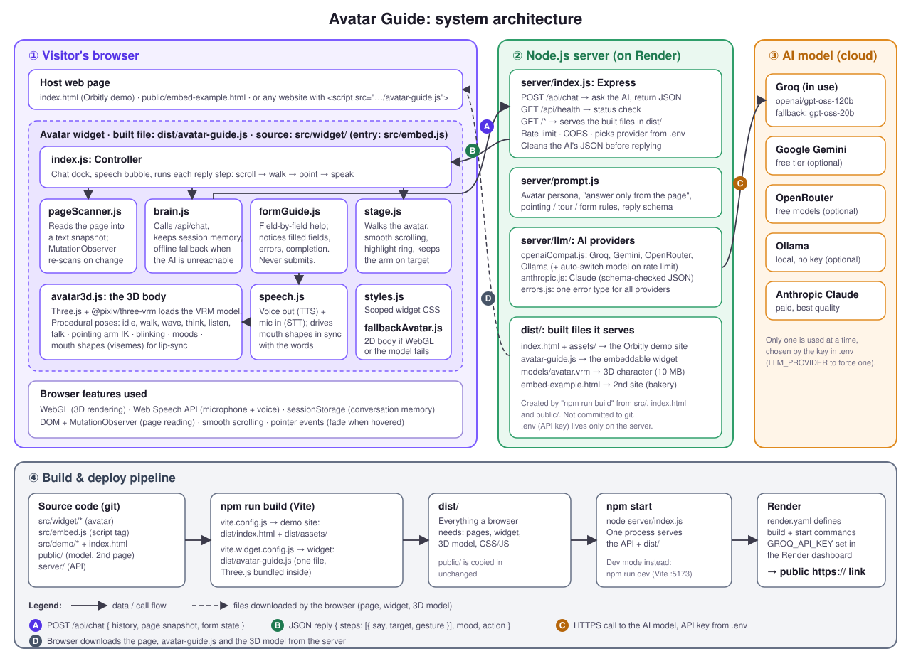
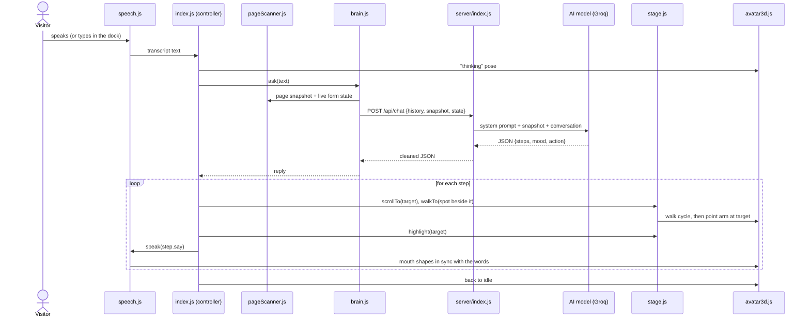

# Architecture: how Avatar Guide is built

Back to the [README](../README.md).



The system has three parts:

| Part | Runs where | Folder | Job |
|---|---|---|---|
| **① Avatar widget** | The visitor's browser | `src/widget/`, entry `src/embed.js` | The 3D character, voice, page reading, walking and pointing, the chat UI |
| **② Server** | Node.js (Render in production) | `server/` | Holds the AI key, talks to the AI model, serves the built files |
| **③ AI model** | Cloud (Groq by default) | (external) | Decides what to say and what to point at, using only the page's content |

The widget never sees the API key. It only talks to our own server.

---

## What happens when a visitor asks a question

Example: the visitor says *"Where can I sign up?"*



1. **Input.** `speech.js` turns the visitor's voice into text, or they type in the dock.
2. **Context.** `pageScanner.js` has already turned the page into a compact text map (sections, headings, text, buttons, links, form fields, each with an id). It re-scans automatically whenever the page changes.
3. **Request.** `brain.js` sends the conversation so far, the page map and the live form state (which fields are filled or have errors, never their values) to `POST /api/chat`.
4. **AI.** `server/index.js` adds the rules from `server/prompt.js`, sends everything to the AI provider in `server/llm/`, and checks and cleans the JSON that comes back.
5. **Reply.** The reply is a list of steps, each `{ say, target, gesture }`, plus a `mood` and an optional `action` (start the form guide, or ask permission to fill a field).
6. **Performance.** For each step, `stage.js` scrolls to the target and walks the avatar beside it without covering it. `avatar3d.js` points the arm at it, the element is highlighted, and `speech.js` speaks the line while moving the avatar's mouth.

**Form walkthrough.** `formGuide.js` watches the form. When a field is completed or shows an error, it sends an automatic `[page event] …` message through the same flow. The avatar then points at the next field or explains the error.

---

## Where each piece of code lives

```
avtartells/
├── index.html                  Demo website (Orbitly product page): hero, features, pricing, FAQ, forms
├── src/
│   ├── embed.js                Entry for the <script> tag: reads data-* options, starts the widget
│   ├── demo/
│   │   ├── demo.css            Demo site styles (dark theme) + dark theme for the widget UI
│   │   └── demo.js             Demo site behaviour: pricing toggle, form validation, "Try asking" buttons
│   └── widget/                 THE AVATAR (everything that runs in the browser)
│       ├── index.js            Controller: builds the UI, runs the conversation, executes reply steps,
│       │                       minimize/hide/summon, permission card for filling fields
│       ├── pageScanner.js      Reads the page into a text snapshot, live form state, offline keyword search
│       ├── brain.js            Calls /api/chat, keeps session memory (sessionStorage), offline fallback
│       ├── avatar3d.js         Three.js + VRM: loads the model, poses (idle/walk/wave/think/listen/talk),
│       │                       pointing-arm IK, blinking, moods, lip-sync mouth shapes
│       ├── stage.js            Moves the avatar across the screen, picks where to stand, smooth scroll,
│       │                       highlight ring, keeps the arm aimed while the page scrolls
│       ├── speech.js           Text-to-speech + speech recognition (Web Speech API), lip-sync timeline
│       ├── formGuide.js        Field-by-field form help: detects completed fields, errors, submit
│       ├── fallbackAvatar.js   Simple 2D full-body avatar if WebGL or the 3D model fails
│       └── styles.js           All widget CSS, scoped under #ag-root, themeable via CSS variables
├── server/                     THE BACKEND (Node.js)
│   ├── index.js                Express app: /api/chat, /api/health, serves dist/, rate limit, CORS,
│   │                           picks the AI provider from .env, cleans the AI's JSON
│   ├── prompt.js               System prompt (persona + rules) and the reply JSON schema
│   └── llm/
│       ├── openaiCompat.js     Groq / Gemini / OpenRouter / Ollama; switches model on rate limits
│       ├── anthropic.js        Claude provider
│       └── errors.js           Shared error type
├── public/                     Copied as-is into dist/ by the build
│   ├── models/avatar.vrm       The 3D character (VRM 1.0, pixiv sample, free to use)
│   └── embed-example.html      A second, unrelated site (bakery) using only the one-line embed
├── docs/                       This document, the diagram, DETAILS.md
├── vite.config.js              Build config for the demo site      → dist/index.html, dist/assets/
├── vite.widget.config.js       Build config for the widget         → dist/avatar-guide.js
├── render.yaml                 Render deployment settings (build/start commands, env vars)
├── .env.example                Template for the API key settings (.env itself is never committed)
└── package.json                Dependencies and scripts: dev, build, start
```

### Generated folders (not in git)

| Folder | Made by | Contents |
|---|---|---|
| `dist/` | `npm run build` | The deployable website: demo pages, `avatar-guide.js`, the 3D model |
| `node_modules/` | `npm install` | Libraries (Three.js, three-vrm, Express, Vite, …) |

---

## Build and deploy

| Command | What it does |
|---|---|
| `npm run dev` | Development: Vite on http://localhost:5173 with live reload, API server on :8787 |
| `npm run build` | Runs Vite twice: once for the demo site, once for the standalone widget bundle. Output goes to `dist/` |
| `npm start` | Production: one Node process serves the API and everything in `dist/` |

On **Render**, `render.yaml` runs `npm install --include=dev && npm run build`, then `npm start`. The `GROQ_API_KEY` is entered in Render's dashboard, never in the code.

---

## Want to change something? Edit this file

| I want to… | Edit |
|---|---|
| Change what the avatar says or how it behaves | `server/prompt.js` |
| Switch the AI provider or model | `.env` (`GROQ_API_KEY`, `LLM_MODEL`, …); providers live in `server/llm/` |
| Use a different 3D character | Replace `public/models/avatar.vrm`, or set `data-model` on the script tag |
| Tweak poses, gestures, walking or pointing | `src/widget/avatar3d.js` |
| Change where it stands or how it walks across the screen | `src/widget/stage.js` |
| Change the chat dock, bubble or colours | `src/widget/styles.js` (or CSS variables on the host page) |
| Change what the avatar "sees" on the page | `src/widget/pageScanner.js` |
| Change form-guidance behaviour | `src/widget/formGuide.js` |
| Change the demo website | `index.html`, `src/demo/` |
| Change embed options (`data-*` attributes) | `src/embed.js` |

---

## Key technology

| Area | Technology |
|---|---|
| 3D rendering | [three.js](https://threejs.org) + [@pixiv/three-vrm](https://github.com/pixiv/three-vrm) (VRM avatar format) |
| Animation | Procedural, written in `avatar3d.js` (no animation files): layered poses, direction-based arm IK |
| Voice | Browser Web Speech API (no extra service or key) |
| AI | Groq `openai/gpt-oss-120b` by default; also Gemini, OpenRouter, Ollama, Claude |
| Server | Node.js + Express |
| Build | Vite (demo site + single-file widget bundle) |
| Hosting | Render (free web service) |
